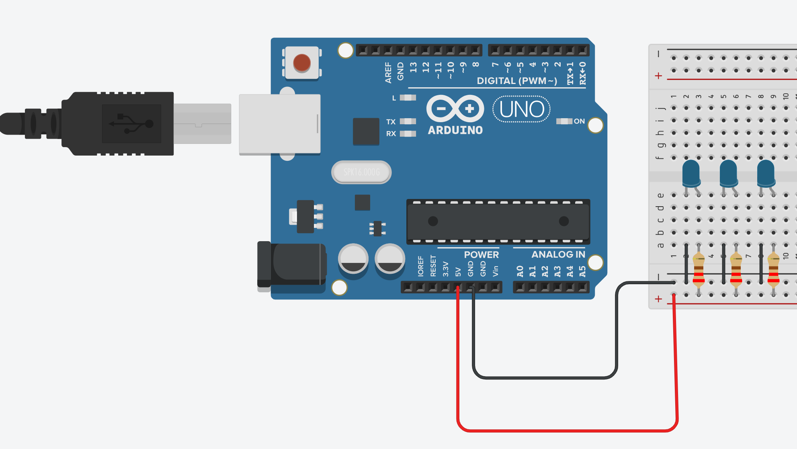

# Signals and Systems

> ** Remove the instructions in block quotes before you submit **

> Design, build, program, and test a signaling system that communicates useful information without a screen or speaker. The red, yellow, and green LEDs 
> automatically cycle through your planned states; no push button is needed. Complete this README as you work. Keep your planning, testing evidence, and 
> link to your video demo here.````````````````

## 1. System purpose

- **Problem and real-world context:** morse code
- **Intended user:** army people
- **What information should your signals communicate?** the phrase the user chooses  
- **How does the user interpret and use that information?** they need to know morse code

## 2. State table and pattern plan

| Step | State/message name | LED Color | LED Color | LED Color | Duration (ms) | Meaning to the user |
| --- | --- | --- | --- | --- | --- | --- |
| A | HI | White | White | White | 5 seconds | HI |
| B | SOS | White | White | White | 6 seconds | SOS |
| C | GOOD NIGHT | White | White | White | 19.5 seconds | GOOD NIGHT |

| A | HI | White | White | White | Duration (ms) | Meaning to the user |
| --- | --- | --- | --- | --- | --- | --- |
| 1 | dot | on | off | off | 250 | short beep |
| 2 | off | off | off | off | 250 | off |
| 3 | dot | on | off | off | 250 | short beep |
| 4 | off | off | off | off | 250 | off |
| 5 | dot | on | off | off | 250 | short beep |
| 6 | off | off | off | off | 250 | off |
| 7 | dot | on | off | off | 250 | short beep |
| 8 | next letter off | off | off | on | 500 | off |
| 9 | dot | on | off | off | 250 | short beep |
| 10 | off | off | off | off | 250 | off |
| 11 | dot| on | off | off | 250 | short beep |
| 12 | next phrase off | off | off | on | 2000 | off |

| B | SOS | White | White | White | Duration (ms) | Meaning to the user |
| --- | --- | --- | --- | --- | --- | --- |
| 1 | dot | on | off | off | 250 | short beep |
| 2 | off | off | off | off | 250 | off |
| 3 | dot | on | off | off | 250 | short beep |
| 4 | off | off | off | off | 250 | off |
| 5 | dot | on | off | off | 250 | short beep |
| 6 | next letter off | off | off | on | 500 | off |
| 7 | dash | on | on | off | 500 | long beep |
| 8 | off | off | off | off | 250 | off |
| 9 | dash | on | on | off | 500 | long beep |
| 10 | off | off | off | off | 250 | off |
| 11 | dash | on | on | off | 500 | long beep |
| 12 | next letter off | off | off | on | 500 | off |
| 13 | dot | on | off | off | 250 | short beep |
| 14 | off | off | off | off | 250 | off |
| 15 | dot | on | off | off | 250 | short beep |
| 16 | off | off | off | off | 250 | off |
| 17 | dot | on | off | off | 250 | short beep |
| 18 | next phrase off | off | off | on | 2000 | off |

| C | GOOD NIGHT | White | White | White | Duration (ms) | Meaning to the user |
| --- | --- | --- | --- | --- | --- | --- |
| 1 | dash | on | on | off | 500 | long beep |
| 2 | off | off | off | off | 250 | off |
| 3 | dash | on | on | off | 500 | long beep |
| 4 | off | off | off | off | 250 | off |
| 5 | dot | on | off | off | 250 | short beep |
| 6 | next letter off | off | off | on | 500 | off |
| 7 | dash | on | on | off | 500 | long beep |
| 8 | off | off | off | off | 250 | off |
| 9 | dash | on | on | off | 500 | long beep |
| 10 | off | off | off | off | 250 | off |
| 11 | dash | on | on | off | 500 | long beep |
| 12 | next letter off | off | off | on | 500 | off |
| 13 | dash | on | on | off | 500 | long beep |
| 14 | off | off | off | off | 250 | off |
| 15 | dash | on | on | off | 500 | long beep |
| 16 | off | off | off | off | 250 | off |
| 17 | dash | on | on | off | 500 | long beep |
| 18 | next letter off | off | off | on | 500 | off |
| 19 | dash | on | on | off | 500 | long beep |
| 20 | off | off | off | off | 250 | off |
| 21 | dot | on | off | off | 250 | short beep |
| 22 | off | off | off | off | 250 | off |
| 23 | dot | on | off | off | 250 | short beep |
| 24 | next word off | off | off | on | 1000 | off |
| 25 | dash | on | on | off | 500 | long beep |
| 26 | off | off | off | off | 250 | off |
| 27 | dot | on | off | off | 250 | short beep |
| 28 | next letter off | off | off | on | 500 | off |
| 29 | dot | on | off | off | 250 | short beep |
| 30 | off | off | off | off | 250 | off |
| 31 | dot | on | off | off | 250 | short beep |
| 32 | next letter off | off | off | on | 500 | off |
| 33 | dash | on | on | off | 500 | long beep |
| 34 | off | off | off | off | 250 | off |
| 35 | dash | on | on | off | 500 | long beep |
| 36 | off | off | off | off | 250 | off |
| 37 | dot | on | off | off | 250 | short beep |
| 38 | next letter off | off | off | on | 500 | off |
| 39 | dot | on | off | off | 250 | short beep |
| 40 | off | off | off | off | 250 | off |
| 41 | dot | on | off | off | 250 | short beep |
| 42 | off | off | off | off | 250 | off |
| 43 | dot | on | off | off | 250 | short beep |
| 44 | off | off | off | off | 250 | off |
| 45 | dot | on | off | off | 250 | short beep |
| 46 | next letter off | off | off | on | 500 | off |
| 47 | dash | on | on | off | 500 | long beep |
| 48 | next phrase off | off | off | on | 2000 | off |

**Sequence:** A → B → C → repeat  

## 3. Circuit design


 
### Ohm's law calculations

> Use `R = (V_output - V_LED) / CURRENT` to estimate the resistance for each LED. Use volts, amperes, and ohms; convert milliamperes to amperes. 
> . Choose a suitable available resistor and check the resulting current using `I = (V_output - V_LED) / R`.

| LED | Arduino output voltage (V) | LED voltage drop (V) | Calculated resistor voltage (V) | Target current (A) | Calculated resistance (Ω) | Chosen resistance (Ω) | Estimated actual current (A) |
| | | | | | | | |
| White LED | 5.0 | 3V | 2V | 0.015A | 130Ω  | 100Ω | 0.02A |
| White LED | 5.0 | 3V | 2V | 0.015A | 130Ω | 100Ω | 0.02A |
| White LED | 5.0 | 3V | 2V | 0.015A | 130Ω | 100Ω | 0.02A |

## 4. Testing and revision


**Person 1:** Very good not confusing but it would be nice to have the morse code alphebet infront of me

**Person 2:** Longer blinks so it is less confusing 

**Did their interpretations match your intended meaning? Explain:** Yes

**Revisions made to the system based on feedback**
make the lights blink for longer periods

**Revision and reason**: I made the lighting up part longer because it would make the pattern more recognizable

**Result after testing the revision:** Very good they get the message along with the system of delivery

## 5. Video Demonstration
> Replace the placeholder below with a link to your video. Demonstrate the complete repeating sequence and explain what each signal communicates. Make sure your instructor can access the video.


[Video demonstration](https://youtube.com/shorts/7jFke8iGS2A)